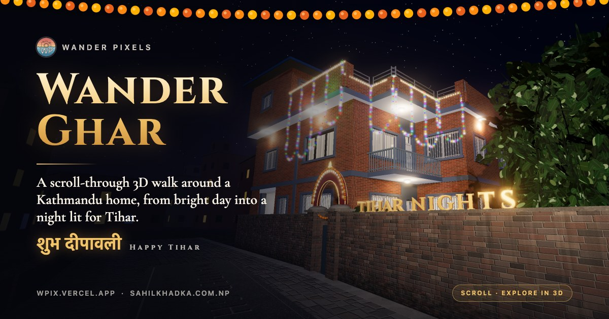
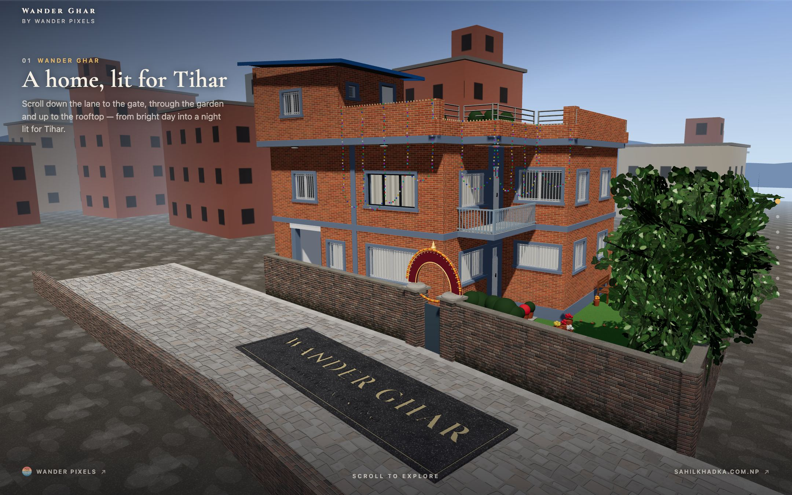
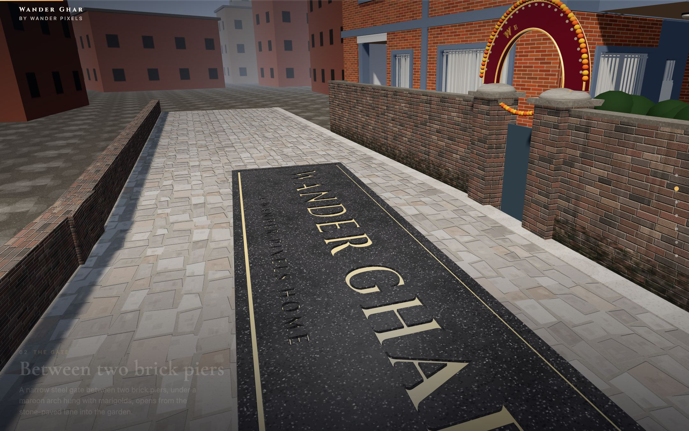
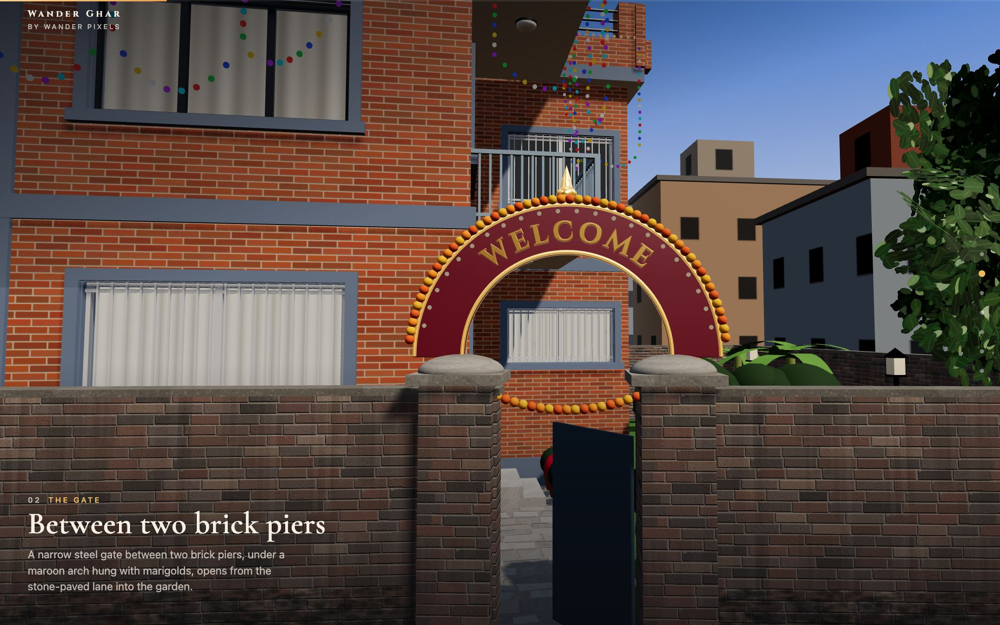
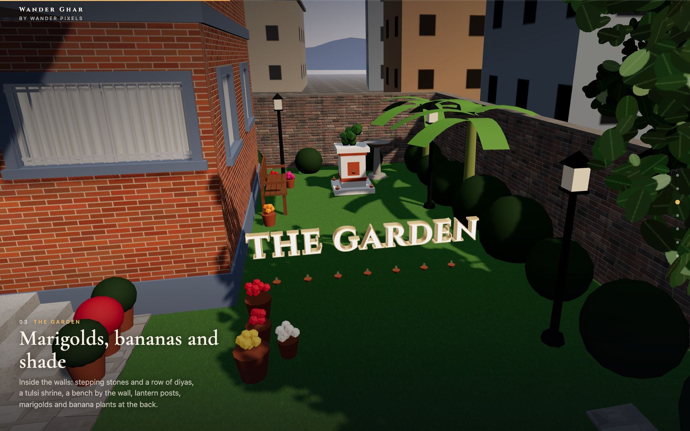
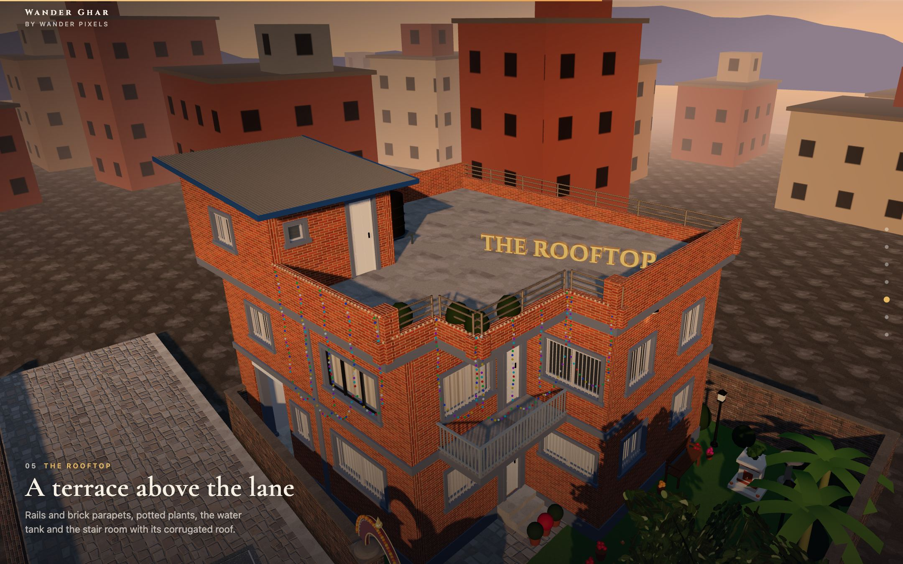
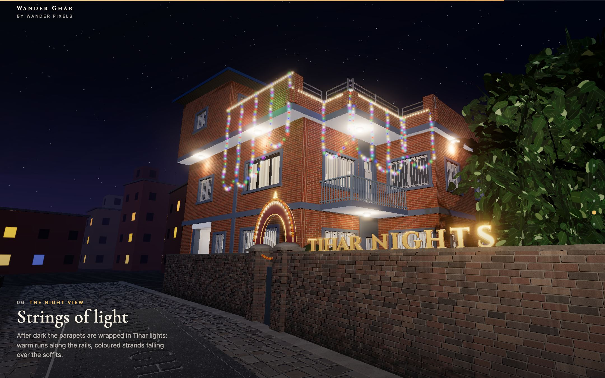
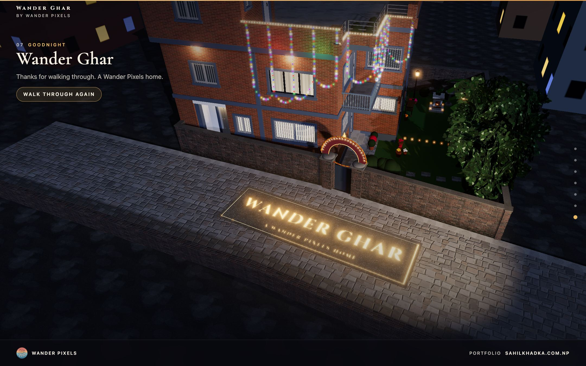
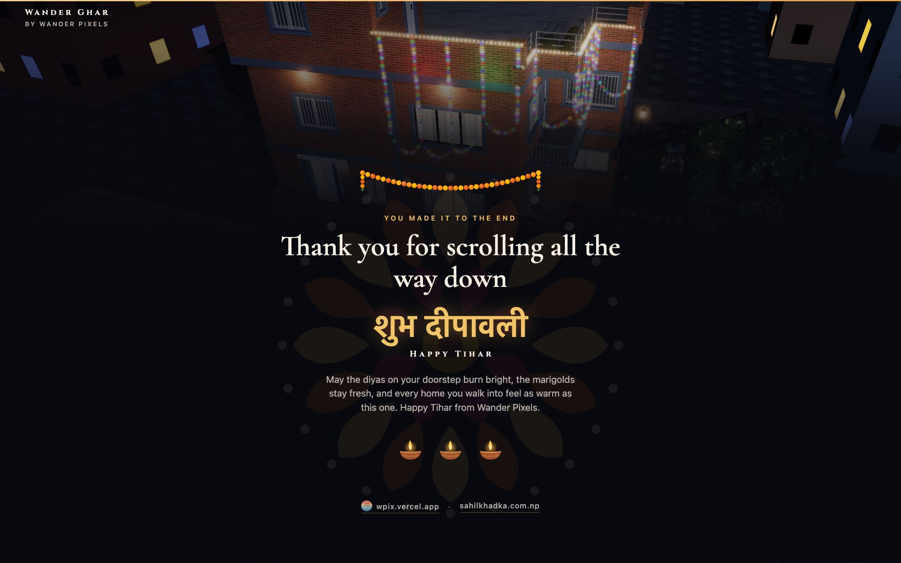
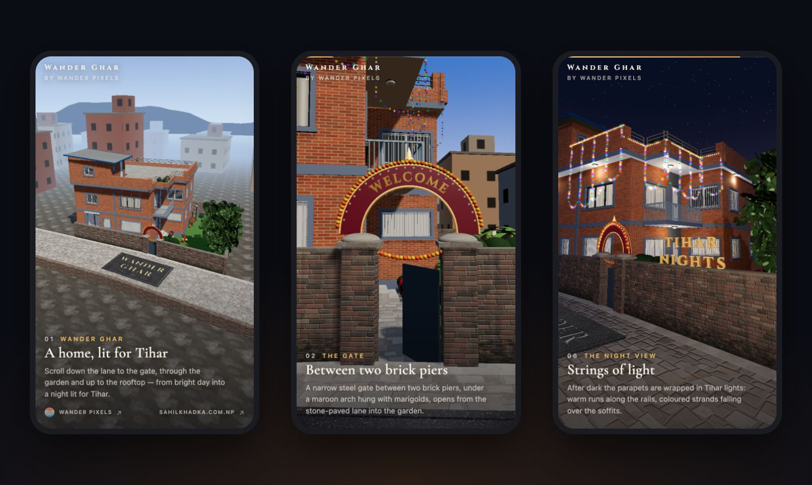

<div align="center">



# Wander Ghar

**A scroll-driven 3D walk around a Kathmandu home, from bright day into a night lit for Tihar.**

[**Live demo**](https://ghar-wpix.vercel.app) · [Wander Pixels](https://wpix.vercel.app) · [Portfolio](https://sahilkhadka.com.np) · Built with [three.js](https://threejs.org), [GSAP](https://gsap.com) and [Lenis](https://lenis.darkroom.engineering)

</div>

---

Scroll down the stone lane, through the marigold-hung gate, across the garden and up to the rooftop. As you go, the sun sets and the house comes alive with Tihar lights. Every surface you see is generated in code: no 3D model files, no photo textures.

## Screenshots

<table>
  <tr>
    <td width="50%"></td>
    <td width="50%"></td>
  </tr>
  <tr>
    <td></td>
    <td></td>
  </tr>
  <tr>
    <td></td>
    <td></td>
  </tr>
  <tr>
    <td></td>
    <td></td>
  </tr>
</table>

<p align="center"></p>

## The tour

| # | Stop | In 3D |
|---|------|-------|
| 1 | **Wander Ghar** | The whole house in daylight; the name is cut into a granite slab in the lane and fills with gold |
| 2 | **The gate** | A low glide down the lane to a maroon arch, gold *WELCOME* lettering and a marigold garland; the gate swings open |
| 3 | **The garden** | Tulsi shrine, bench, lantern posts, pots, a birdbath and a row of diyas |
| 4 | **The balcony** | Lettering perched on the steel handrail |
| 5 | **The rooftop** | The terrace in the evening light |
| 6 | **The night view** | Sunset turns to night and the Tihar lights come on |
| 7 | **Goodnight** | The glowing name plate, then a closing *शुभ दीपावली* message |

## Highlights

- **Real 3D type**: extruded, bevelled Cinzel letters that animate with the scroll, plus a name plate with the letters actually carved into the stone.
- **Day to night on one scrollbar**: sky, sun, shadows, window glow, bloom and bulb halos all follow scroll position.
- **Smooth on any phone**: low/mid/high quality tiers by device, an auto-scaler that lowers resolution if frames slow, and separate portrait camera framings.
- **Link previews**: Open Graph and X cards with a custom 1200×630 preview image.

## Getting started

```bash
npm install
npm run dev        # http://localhost:5174 (the tour) and /viewer.html (model inspector)
npm run build      # type-checks, then builds to dist/
```

Link previews need absolute URLs. The build fills them in from `SITE_URL`, or automatically on Vercel and Netlify, and otherwise falls back to the live address, <https://ghar-wpix.vercel.app> (set in `vite.config.ts`).

```bash
SITE_URL=https://your-domain.com npm run build
```

Add `?q=low`, `?q=mid` or `?q=high` to the URL to force a quality tier.

## Project structure

```
index.html              the scroll tour (captions, footer, meta tags)
viewer.html             orbit inspector for the house model
src/house/              procedural house: layout, geometry, textures, materials, garden, lights
src/tour/               the tour: camera rail, chapters, 3D text, engraving, gate banner,
                        garden extras, sky, quality tiers, closing section
scripts/                screenshots, typeface conversion, browser checks
public/                 preview image, icons
```

To adjust the tour, edit `src/tour/chapters.ts`: it holds every camera stop, text placement and time of day.

## How the house was made

The house model was rebuilt from a single night photo with **[img2threejs](https://github.com/img2threejs/img2threejs)**, an open-source workflow that reconstructs the object in a reference image as a code-only procedural Three.js model. It fits the camera to the photo and builds the model in quality-gated passes. Huge thanks to its authors.

The original photo is private and isn't in this repository. Without it, the viewer's photo-compare slider simply stays hidden.

## Checks

Two snippets run inside the page through [agent-browser](https://github.com/vercel-labs/agent-browser) or any devtools console:

```bash
agent-browser eval "$(cat scripts/tour-check.js)"   # every stop's text in frame, unobstructed, clear of captions
agent-browser eval "$(cat scripts/tour-scroll.js)"  # frame times and camera continuity over a full scroll
```

## Credits

- [img2threejs](https://github.com/img2threejs/img2threejs) (Apache-2.0): image-to-Three.js reconstruction of the house
- [three.js](https://threejs.org), [GSAP](https://gsap.com), [Lenis](https://github.com/darkroomengineering/lenis)
- Fonts: [Cinzel](https://fonts.google.com/specimen/Cinzel) and [Cormorant Garamond](https://fonts.google.com/specimen/Cormorant+Garamond), SIL Open Font License 1.1 (the 3D typeface in `src/tour/fonts/` is converted from Cinzel)

## License

No open-source license has been chosen yet, so all rights are reserved by the author. Third-party parts keep their own licenses, listed above.

---

<div align="center">

Made with care by **[Wander Pixels](https://wpix.vercel.app)** · **[sahilkhadka.com.np](https://sahilkhadka.com.np)**

शुभ दीपावली ✨

</div>
